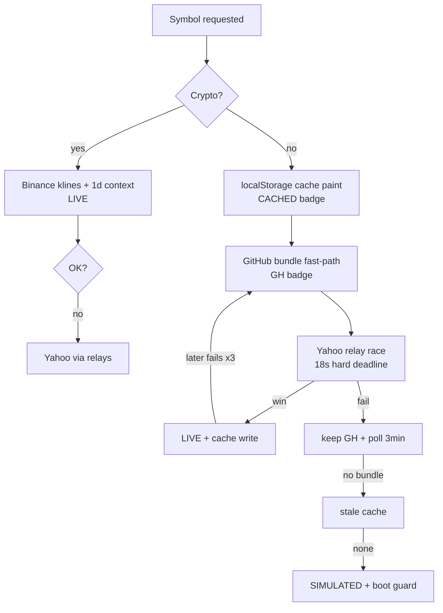
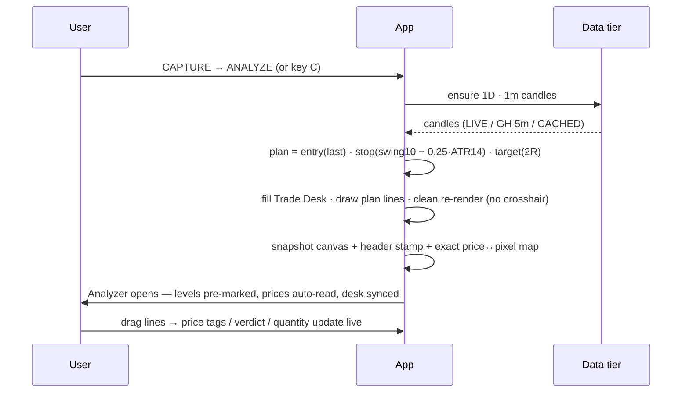

# 🏗 Architecture

## Design principles

1. **One file.** `index.html` — no build step, no framework, no dependencies except an icon font. Anyone can read the whole system in one sitting.
2. **Client-only.** All math (indicators, R-multiples, grading, sizing) runs in the browser. No server sees your account size, journal, or plan.
3. **Fail visible, never fail silent.** Every data state is badged (`LIVE` / `GH · DELAYED` / `CACHED` / `SIMULATED`). A loading state can never hang — hard deadlines and a boot guard guarantee an exit.
4. **Request budget discipline.** Public CORS relays are shared by everyone, so the app budgets requests: cached paints, bundle-first tape, debounced search, ≤3 concurrent relay calls, health-scored relay selection.

## Module map (inside `index.html`)

| Section | Responsibility |
|---|---|
| `CONFIG` | Optional `MY_WORKER`, `GH_DATA_URL`, `KEYS.finnhub` |
| utils | formatting, seeded RNG (sim), toasts, localStorage helpers |
| `DIR` / `TFS` / `CRYPTO_MAP` / `SIMBASE` | symbol directory, timeframe table, crypto pairs, simulated baselines |
| Currency layer | native-currency storage (`app.raw`) → single conversion boundary → display currency |
| Network layer | relay pool (health-scored), 3-slot concurrency gate, `netJSON` race, `deadline()` |
| GH tier | bundle auto-discovery (raw.githubusercontent → same-origin), 10-min refresh |
| Providers | `yahooChart`, `binanceSeries`, `snapshotSeries`, `simSeries` — all return **native-currency** series |
| Indicators | EMA, RSI, ATR (Wilder), VWAP, Bollinger — hand-rolled |
| Chart engine | canvas candles/volume/overlays, crosshair, zoom/pan, plan lines; exposes the price↔pixel map (`chart.lastY`) |
| **Capture pipeline** | force 1D·1m → compute fresh swing+ATR plan → snapshot with exact scale → pre-mark & sync analyzer |
| Feed orchestration | per-mode polls (LIVE 30s · GH 3min · SIM 1.4s), Binance WebSocket with REST fallback |
| Trade Desk | sizer, R-table, dial, armed trades, checklist modal |
| Analyzer | line-dragging = price input (capture map or 2-point calibration or manual), live verdict, desk sync |
| Exit planner · Journal · MY PLAN · Tape · Search · Guide | feature tabs |

## Data-tier decision flow



## Capture → Analyze sequence



The snapshot carries `{mn, mx, padT, priceH, capH, totalH}` so the analyzer converts any vertical fraction back to an exact price — that’s why captured levels are correct regardless of zoom or window size.

## GitHub bundle schema (`bundle.json`, branch `data`)

```json
{
  "ts": 1730000000000,
  "AAPL": {
    "cur": "USD",
    "p": 231.4,
    "pc": 229.8,
    "m5":  [[t, o, h, l, c, v], "…≤78 bars"],
    "m15": [[t, o, h, l, c, v], "…≤130 bars"],
    "d1":  [[t, o, h, l, c, v], "…≤252 bars"]
  },
  "RELIANCE.NS": { "cur": "INR", "…": "…" }
}
```

Discovery order: `GH_DATA_URL` const (set to `https://raw.githubusercontent.com/KBgirishHB/Onepercentage/data/bundle.json`) → auto-derived `raw.githubusercontent.com/<owner>/<repo>/data/bundle.json` on `*.github.io` → same-origin `data/bundle.json`.

## localStorage keys

| Key | Contents |
|---|---|
| `op_journal` | trade journal (R-based) |
| `op_profile` | MY PLAN wizard answers |
| `op_cur`, `op_fx`, `op_fx_ts` | display currency + FX rate cache |
| `op_recents` | recent symbols |
| `op_tape` | last good tape (1h TTL) |
| `op_c\|SYM\|TF\|IV` | per-series cache (36-entry LRU, instant re-paints) |

## Extend it

| Add… | Touch |
|---|---|
| A symbol | `DIR` + `SIMBASE` in `index.html`; optionally `SYMS` in the workflow YAML |
| A tape symbol | `TAPE` array (bundle symbols cost zero relay calls) |
| An indicator | one array function beside `emaArr`; add an `.ind` button + a `line()` call |
| A relay | one entry in `RELAYS` (`{n, build, extract?}`) — put your Worker first |
| A timeframe | one entry in `TFS` (+ `BPLAN` for crypto) |

## Request budget

| Consumer | Relay cost | Cadence |
|---|---|---|
| Ticker tape | **0** (bundle / Binance) | 5 min |
| Chart poll (LIVE) | 1 | 30 s |
| GH bundle refresh | 0 (raw.githubusercontent) | 3–10 min |
| FX rate (INR mode) | 1 | 24 h |
| Search | debounced ≥1.2 s | on typing |
| Concurrency | ≤3 simultaneous relay calls | always |

## Honest limitations

- Browsers can’t call Yahoo directly (no CORS) — static hosts need the relay/bundle/Worker tiers. This is a platform constraint, not a bug.
- True 1-minute candles require the LIVE tier; the GH bundle carries 5m/15m/1D and captures stamp the real interval honestly.
- Simulated mode is for practising the workflow only — it is always badged.
- No authentication, no order execution, no broker connectivity by design.
