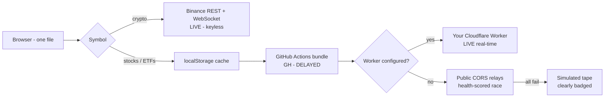

<div align="center">

# ONEPERCENT

**The risk-first market terminal that lives in a single `index.html`**

Real-time stocks and crypto | the 1% rule enforced everywhere | no backend | no API keys

**Language:** **English** | [Deutsch](README.de.md) | [中文](README.zh.md) | [Dansk](README.da.md)

[](https://kbgirishhb.github.io/Onepercentage/)
[](LICENSE.txt)
[](docs/DEPLOYMENT.md)
[](#architecture-30-second-version)

[User Guide](docs/USER_GUIDE.md) | [Deployment](docs/DEPLOYMENT.md) | [Architecture](docs/ARCHITECTURE.md) | [Report an Issue](../../issues)

</div>

---

## Why ONEPERCENT exists

Every trading app shows you prices. Almost none forces you to **size the position, place the stop, and plan the exit** before you get excited.

ONEPERCENT is built backwards from risk. The **1% rule** is the spine, and everything else (charts, signals, the screenshot grader) exists to answer one question:

> **What exactly do I buy, how much of it, where am I wrong, and when do I walk away with the money?**

## Features

| Feature | What it does |
|---|---|
| **Live market data** | Stocks, ETFs, indices, Indian names (`.NS`) and crypto. Keyless, with a tiered fallback chain so the app never dies |
| **Hand-built candlestick chart** | 7 timeframes (1D to 5Y), 1m to 1w intervals, zoom, pan, crosshair, volume. No chart libraries |
| **Indicators** | EMA20/50, VWAP, Bollinger Bands, Volume, plus RSI and ATR signals with plain-English reads |
| **1% Risk Engine** | Daily risk dial with a hard ceiling, position sizer (exact quantity from stop distance), allocation cap, fee-aware breakeven |
| **Capture and Analyze** | One click switches to the 1-minute chart, computes a fresh swing+ATR plan, snapshots it and grades R:R in the analyzer, with levels pre-marked and synced |
| **Screenshot Analyzer** | Drop or paste any broker screenshot, calibrate two gridlines, drag three lines for a live verdict: TAKE, MARGINAL or REJECT (under 2R is rejected) |
| **Exit / Withdraw Planner** | Four strategies (Sniper, Scale-out, Time-stop, ATR trail) with duration estimated from live ATR |
| **Trade Journal** | R-multiple based, auto-logged on close. Win rate, expectancy and equity curve, stored on your device only |
| **MY PLAN and Timings** | Live IST and ET clocks, open/close countdowns, hour-by-hour trading windows, and a 4-question wizard that builds your personal plan |
| **USD / INR** | One toggle converts the whole terminal at the live FX rate (24h cache, offline fallback) |
| **Honest feed badges** | `LIVE`, `GH - DELAYED`, `CACHED`, `SIMULATED`. Simulated data is never passed off as real |
| **Keyboard-first** | `/` search, `1-7` timeframes, `C` capture, `?` guide |

## The 1% engine in 20 seconds

```text
Account INR 8,00,000  ->  daily risk budget INR 8,000   (1%)
Stop is INR 20 away   ->  quantity = 8,000 / 20 = 400 shares
Stopped out?          ->  you lose exactly INR 8,000 = 1%, survivable and repeatable
Target at 2R          ->  you only need about 40% winners to grow
```

The dial caps the whole day at 1%. Arming a trade requires passing a 5-point pre-flight checklist, including "I will not move my stop further away."

## Try it in 60 seconds

1. Open the [live demo](https://kbgirishhb.github.io/Onepercentage/), or download `index.html` and double-click it
2. Pick **USD / INR** in the header and enter your account size
3. Press `/`, type any stock, then **AUTO PLAN**, then **CAPTURE > ANALYZE (1m)**
4. Read the verdict: **TAKE** means at least 2R with a defined stop. Anything else is a lesson, not a trade.

## Deploy your own (free, about 5 minutes)

GitHub Pages hosts it as-is: one file, no build step.

1. Create a public repository (this one is `Onepercentage`)
2. Upload `index.html` to `main`
3. Settings > Pages > Deploy from a branch > `main` / (root)
4. Done: https://kbgirishhb.github.io/Onepercentage/

Full click-by-click guide: [docs/DEPLOYMENT.md](docs/DEPLOYMENT.md)

### Unlock real-time data (optional, still free)

Static pages cannot call Yahoo directly (no CORS headers), so the app ships with a fallback chain. To make it robust:

| Fix | What you get | Setup |
|---|---|---|
| **A - GitHub Action** | A snapshot refreshed every 5 min, so real data is guaranteed (`GH - DELAYED` badge) | DEPLOYMENT.md section 4, one YAML file |
| **B - Cloudflare Worker** | Your private proxy for true real-time (`LIVE` badge, 100k requests/day free) | DEPLOYMENT.md section 5, 12 lines |
| **C - Finnhub key** (optional) | Real-time quote upgrades on top of any tier | DEPLOYMENT.md section 6, one constant |

## Documentation

| Doc | Contents |
|---|---|
| [User Guide](docs/USER_GUIDE.md) | Every feature, IST market timings, broker quick-steps, indicator cheat-sheet, glossary |
| [Deployment](docs/DEPLOYMENT.md) | GitHub Pages, GitHub Action, Cloudflare Worker and Finnhub setup, with checklists |
| [Architecture](docs/ARCHITECTURE.md) | Data-tier flow, capture pipeline, bundle schema, extension recipes |

## Architecture (30-second version)



All math (indicators, R-multiples, grading, sizing) runs in your browser. Nothing about you leaves the device. Details: [ARCHITECTURE.md](docs/ARCHITECTURE.md).

## Built on the shoulders of

| Repo | What it informed |
|---|---|
| [`TradingView/lightweight-charts`](https://github.com/TradingView/lightweight-charts) | Chart UX reference (ours is hand-rolled to stay single-file) |
| [`ranaroussi/yfinance`](https://github.com/ranaroussi/yfinance) | Yahoo endpoint behaviour |
| [`gadicc/node-yahoo-finance2`](https://github.com/gadicc/node-yahoo-finance2) | Chart-API edge cases and rate limits |
| [`twopirllc/pandas-ta`](https://github.com/twopirllc/pandas-ta) | Indicator definitions |
| [`backtrader/backtrader`](https://github.com/backtrader/backtrader) | Exit-strategy concepts |
| [`Zibri/cloudflare-cors-anywhere`](https://github.com/Zibri/cloudflare-cors-anywhere) | The Worker relay pattern |
| [`public-apis/public-apis`](https://github.com/public-apis/public-apis) | Market-data landscape survey |

## Roadmap

- [x] 1% risk engine: sizer, daily dial, checklist
- [x] Capture and Analyze 1-minute pipeline
- [x] USD/INR conversion, IST market timings, personal plan wizard
- [x] GitHub Action data tier
- [ ] Price alerts with browser notifications
- [ ] Daily screener
- [ ] Backtested stats per exit strategy
- [ ] Hindi UI
- [ ] PWA offline mode

## Contributing

Issues and PRs are welcome, especially new symbols or relays (one-line additions, see ARCHITECTURE "Extend it") and bug reports with a screenshot showing the feed badge and timeframe. Code rule: it must stay **one file, no build step, no required keys**.

## FAQ

**Does it place real orders?** No. It is analysis and discipline tooling. You execute in your broker app.

**Is the data delayed?** The badge tells you: `LIVE` (real-time), `GH - DELAYED` (up to about 10 min), `CACHED` (your last real data), `SIMULATED` (not real, never trade on it).

**Why do stocks need Fix A/B when crypto just works?** Binance sends open CORS headers; Yahoo does not. Browsers cannot call Yahoo directly.

**What does it cost?** Nothing. GitHub Pages, Actions and the Cloudflare free tier cover everything.

## Disclaimer

ONEPERCENT is an **educational tool**. Nothing here is investment advice. Market data may be delayed, incomplete or, when the badge says so, simulated. Always verify prices with your broker before acting. Trading involves substantial risk of loss.

## License

[MIT](LICENSE.txt)
