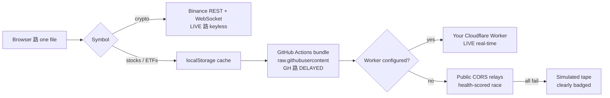

<div align="center">

# 馃幆 ONEPERCENT

**The risk-first market terminal that lives in a single `index.html`**

*Real-time stocks & crypto 路 the 1% rule enforced everywhere 路 no backend 路 no API keys*

[](https://kbgirishhb.github.io/Onepercentage/)
[](LICENSE.txt)
[](docs/DEPLOYMENT.md)
[](#-architecture-30-second-version)
[](#)

[User Guide](docs/USER_GUIDE.md) 路 [Deployment](docs/DEPLOYMENT.md) 路 [Architecture](docs/ARCHITECTURE.md) 路 [Report an Issue](../../issues)

</div>

---

## Why ONEPERCENT exists

> Every trading app shows you prices. Almost none forces you to **size the position, place the stop, and plan the exit** *before* you get excited.
>
> ONEPERCENT is built backwards from risk: the **1% rule** is the spine, and everything else 鈥?charts, signals, the screenshot grader 鈥?exists to answer one question:
>
> **鈥淲hat exactly do I buy, how much of it, where am I wrong, and when do I walk away with the money?鈥?*

## 鉁?Features

| | Feature | What it does |
|---|---|---|
| 馃搱 | **Live market data** | Stocks, ETFs, indices, Indian names (`.NS`), crypto 鈥?keyless, with a tiered fallback chain so the app never dies |
| 馃暞 | **Hand-built candlestick chart** | 7 timeframes (1D鈫?Y), 1m鈥?w intervals, zoom / pan / crosshair / volume 鈥?zero chart libraries |
| 馃帥 | **Indicators** | EMA20/50, VWAP, Bollinger Bands, Volume, plus RSI & ATR signals with plain-English reads |
| 馃洝 | **1% Risk Engine** | Daily risk dial with a **hard ceiling**, position sizer (exact quantity from stop distance), allocation cap, fee-aware breakeven |
| 馃摳 | **Capture 鈫?Analyze** | One click: switches to the **1-minute chart**, computes a fresh swing+ATR plan, snapshots it, and grades R:R in the analyzer 鈥?levels pre-marked & synced |
| 馃柤 | **Screenshot Analyzer** | Drop/paste *any* broker screenshot, calibrate two gridlines, drag three lines 鈫?live verdict: **TAKE / MARGINAL / REJECT** (anything under 2R is rejected) |
| 鈴?| **Exit / Withdraw Planner** | 4 strategies 鈥?Sniper, Scale-out, Time-stop, ATR trail 鈥?with duration estimated from live ATR in real sessions |
| 馃摀 | **Trade Journal** | R-multiple based, auto-logged on close; win rate, expectancy, equity curve 鈥?stored on your device only |
| 馃審 | **MY PLAN & Timings** | Live **IST + ET clocks**, open/close countdowns, hour-by-hour 鈥渨hen should *you* trade鈥?windows, and a 4-question wizard that builds your personal plan |
| 馃挶 | **USD 鈬?INR** | One toggle converts the entire terminal at the live FX rate (24h cache, offline fallback) |
| 馃И | **Honest feed badges** | `LIVE` / `GH 路 DELAYED` / `CACHED` / `SIMULATED` 鈥?simulated data is never passed off as real |
| 鈱笍 | **Keyboard-first** | `/` search 路 `1鈥?` timeframes 路 `C` capture 路 `?` guide |

## 馃Л The 1% engine in 20 seconds

```text
Account 鈧?,00,000   鈫? daily risk budget 鈧?,000        (1%)
Stop is 鈧?0 away    鈫? quantity = 8,000 梅 20 = 400 shares
Stopped out?        鈫? you lose exactly 鈧?,000 = 1% 鈥?survivable, repeatable
Target at 2R        鈫? you only need ~40% winners to grow
```

The dial caps the **whole day** at 1%. Arming a trade requires passing a 5-point pre-flight checklist 鈥?including *鈥淚 will not move my stop further away.鈥?

## 馃殌 Try it in 60 seconds

1. Open the **[live demo](https://kbgirishhb.github.io/Onepercentage/)** 鈥?or download `index.html` and double-click it
2. Pick **USD $ / INR 鈧?* in the header, enter your account size
3. Press `/`, type any stock 鈫?**AUTO PLAN** 鈫?**CAPTURE 鈫?ANALYZE (1m)**
4. Read the verdict: **TAKE** = 鈮?R with a defined stop. Everything else is a lesson, not a trade.

## 馃摝 Deploy your own (free, ~5 minutes)

GitHub Pages hosts it as-is 鈥?one file, no build step.

```text
1. create a PUBLIC repo (this one is "Onepercentage")
2. upload index.html to main
3. Settings 鈫?Pages 鈫?Deploy from a branch 鈫?main / (root)
4. done 鈫?https://kbgirishhb.github.io/Onepercentage/
```

**Full click-by-click guide 鈫?[docs/DEPLOYMENT.md](docs/DEPLOYMENT.md)**

### Unlock real-time data (optional, still free)

Static pages can鈥檛 call Yahoo directly (no CORS headers), so the app ships with a smart fallback chain. To make it bulletproof:

| Fix | What you get | Setup |
|---|---|---|
| **A 鈥?GitHub Action** | A snapshot refreshed every 5 min 鈫?**guaranteed real data** (`GH 路 DELAYED` badge) | 搂4 of DEPLOYMENT.md 鈥?one YAML file |
| **B 鈥?Cloudflare Worker** | Your private proxy 鈫?**true real-time** (`LIVE` badge, 100k req/day free) | 搂5 of DEPLOYMENT.md 鈥?12 lines |
| **C 鈥?Finnhub key** (optional) | Real-time quote upgrades on top of any tier | 搂6 of DEPLOYMENT.md 鈥?one constant |

## 馃摳 Screenshots

Save captures into `docs/screenshots/` with these filenames, then add them here:

| Filename | What to capture |
|---|---|
| `terminal.png` | Full workspace 鈥?chart + Trade Desk + signals |
| `capture-analyze.png` | The analyzer with pre-marked ENTRY / STOP / TARGET |
| `plan.png` | MY PLAN tab with the live IST clocks |
| `exit-planner.png` | A scale-out schedule |
| `journal.png` | The journal with a few logged trades |

## 馃梻 Documentation

| Doc | Contents |
|---|---|
| [User Guide](docs/USER_GUIDE.md) | Every feature, **IST market timings**, broker quick-steps, indicator cheat-sheet, glossary |
| [Deployment](docs/DEPLOYMENT.md) | GitHub Pages setup + GitHub Action + Cloudflare Worker + Finnhub, with verification checklists |
| [Architecture](docs/ARCHITECTURE.md) | Data-tier decision flow, capture pipeline, bundle schema, extension recipes |

## 馃彈 Architecture (30-second version)



All math 鈥?indicators, R-multiples, grading, sizing 鈥?runs **in your browser**. Nothing about you leaves the device. Full details in [ARCHITECTURE.md](docs/ARCHITECTURE.md).

## 馃敩 Built on the shoulders of

| Repo | What it informed |
|---|---|
| [`TradingView/lightweight-charts`](https://github.com/TradingView/lightweight-charts) | chart UX reference 鈥?we hand-rolled ours to stay single-file |
| [`ranaroussi/yfinance`](https://github.com/ranaroussi/yfinance) | Yahoo endpoint behaviour |
| [`gadicc/node-yahoo-finance2`](https://github.com/gadicc/node-yahoo-finance2) | chart-API edge cases & rate limits |
| [`twopirllc/pandas-ta`](https://github.com/twopirllc/pandas-ta) | indicator definitions (EMA/RSI/ATR/VWAP/Bollinger) |
| [`backtrader/backtrader`](https://github.com/backtrader/backtrader) | exit-strategy concepts (scale-out, chandelier) |
| [`Zibri/cloudflare-cors-anywhere`](https://github.com/Zibri/cloudflare-cors-anywhere) | the Worker relay pattern |
| [`public-apis/public-apis`](https://github.com/public-apis/public-apis) | market-data landscape survey |

## 馃椇 Roadmap

- [x] 1% risk engine 鈥?sizer, daily dial, checklist
- [x] Capture 鈫?Analyze 1-minute pipeline
- [x] USD/INR conversion 路 IST market timings 路 personal plan wizard
- [x] GitHub-Action data tier (real data on a static host)
- [ ] Price alerts with browser notifications
- [ ] Daily screener 鈥?top movers matching your signal profile
- [ ] Backtested stats per exit strategy
- [ ] Hindi UI
- [ ] PWA offline mode

## 馃 Contributing

Issues and PRs welcome 鈥?especially:

- **new symbols / relays** (each is a one-line addition 鈥?see ARCHITECTURE 搂Extend)
- **bug reports** with a screenshot showing the feed badge + timeframe
- code style rule: it must stay **one file, no build step, no required keys**

## 鉂?FAQ

**Does it place real orders?** No 鈥?it鈥檚 analysis + discipline tooling. You execute in your broker app; the User Guide鈥檚 鈥淨uick Steps鈥?covers the workflow.

**Is the data delayed?** The badge always tells you: `LIVE` (real-time) 路 `GH 路 DELAYED` (鈮?~10 min) 路 `CACHED` (your last real data) 路 `SIMULATED` (not real 鈥?never trade on it).

**Why do stocks need 鈥淔ix A/B鈥?when crypto just works?** Binance sends open CORS headers; Yahoo doesn鈥檛. Browsers cannot call Yahoo directly 鈥?搂4/搂5 of the Deployment guide solve it permanently.

**What does it cost?** Nothing. GitHub Pages, Actions, and the Cloudflare Worker free tier cover everything.

## 鈿狅笍 Disclaimer

ONEPERCENT is an **educational tool**. Nothing here is investment advice. Market data may be delayed, incomplete, or 鈥?when the badge says so 鈥?simulated. Always verify prices with your broker before acting. Trading involves substantial risk of loss; the 1% rule exists because **survival is the prerequisite of every other skill in the market**.

## License

[MIT](LICENSE.txt) 鈥?do whatever you like; keep the disclaimer.

<div align="center">

**If ONEPERCENT saved you from one oversized position, consider 猸?starring the repo.**

</div>
